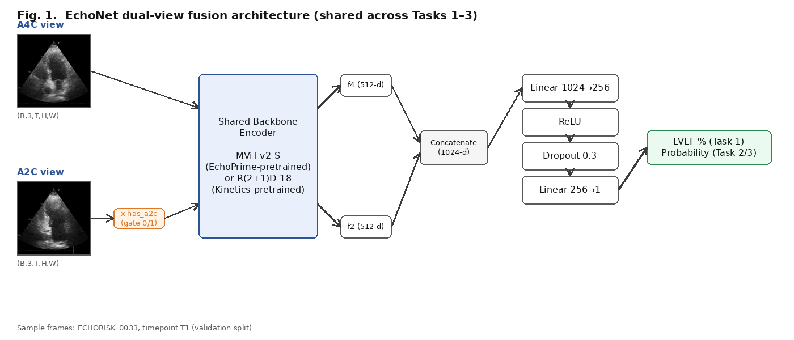

# Deep Learning for Cardio-Oncology Surveillance: LVEF Estimation, LV Dysfunction Classification, and Early Cardiotoxicity Prediction from Echocardiography

> **Status: internal draft.** Anonymise before OpenReview submission (remove this status line, author/affiliation info, and the repo path references in §3). Target venue: EchoRisk-MICCAI 2026 / STACOM. Initial submission limit: 8 pages + 2 pages references, PDF, official LNCS template. This draft reports validation-set results only, per the rules for the 1 Jul 2026 deadline; camera-ready (27 Aug 2026, ≤12 pages) will add test-set numbers from the official Docker evaluation.

## Abstract

*(150–250 words — draft after Results are finalised. Must state: task(s) addressed, method in one sentence, headline validation metrics for each task, and end with the registered team name.)*

Team: **[TEAM NAME]**

---

## 1. Introduction

Therapy-induced cardiotoxicity surveillance in breast cancer treatment relies on echocardiographic assessment that is operator-dependent and variable across readers. We address all three EchoRisk-MICCAI 2026 tasks — (1) LVEF estimation, (2) LV dysfunction classification, and (3) early prediction of cardiotoxicity from baseline imaging alone — with a single shared architecture, comparing a video-action-recognition backbone against a domain-pretrained echocardiography backbone. Our contribution is an empirical comparison of these two backbones under identical dual-view fusion and task heads, together with a transfer-learning study for Task 3, where the training set is small (157 patients) and naive fine-tuning destroys useful pretrained features.

---

## 2. Method

### 2.1 Problem Formulation

| Task | Output | Primary metric | Label |
|---|---|---|---|
| 1 — LVEF Estimation | `lvef_pred ∈ [0,100]` per exam | MAE ↓ (clinical target ≤5%) | `lvef` |
| 2 — LV Dysfunction Classification | `dysfunction_pred ∈ [0,1]` per exam | AUC-ROC ↑ | `lv_dysfunction` (GLS ≥ −16%) |
| 3 — Early Cardiotoxicity Prediction | `cardiotoxicity_pred ∈ [0,1]` per patient, baseline (T1) only | AUC-ROC ↑ (clinical target: sensitivity ≥80% at FPR 10–20%) | `cardiotoxicity` |

All three tasks share the same dual-view input: apical 4-chamber (A4C) and apical 2-chamber (A2C) cine DICOMs per exam, with A2C frequently missing and handled via a learned gate (§2.2).

### 2.2 Architecture — `EchoNet`

A shared encoder processes each view independently; the two 512-d embeddings are concatenated and passed through a task-agnostic MLP head (Fig. 1).

**Fig. 1.** EchoNet dual-view fusion architecture, shared across Tasks 1–3. Input thumbnails are real validation-split frames (patient `ECHORISK_0033`, timepoint T1). A2C features are gated to zero when the view is absent (`has_a2c = 0`).

Output is a raw scalar: clamped to `[0,100]` for Task 1 regression, passed through sigmoid for Tasks 2–3 classification.

We evaluate **two backbones** under this identical head:

| | **Baseline** | **EchoPrime (primary)** |
|---|---|---|
| Backbone | R(2+1)D-18 | MViT-v2-S |
| Pretraining | Kinetics-400 (general video action recognition) | EchoPrime self-supervised echocardiography pretraining [1] |
| Input | `(B,1,32,112,112)`, grayscale repeated to 3ch | `(B,3,16,224,224)` |
| Normalisation | ImageNet-style, `[0,1]` scale | EchoPrime stats on raw `[0,255]` scale: mean=[29.11, 28.08, 29.10], std=[47.99, 46.46, 47.20] |
| Frame sampling | 32 frames, `np.linspace` uniform | 16 frames, stride-2 uniform |

The EchoPrime backbone is domain-pretrained directly on echocardiography (vision-language pretraining on paired echo studies and reports [1]), motivating its use as our primary pipeline; the R(2+1)D-18/Kinetics-400 model serves as a generic-video-pretraining baseline for comparison.

### 2.3 Task-Specific Training Strategy

- **Tasks 1 & 2**: full end-to-end fine-tuning of backbone + head. Task 1 uses Huber loss (`δ=5.0`, robust to rare low-LVEF outliers); Task 2 uses weighted BCE with `pos_weight = n_neg/n_pos` from the training label distribution (baseline pipeline instead used focal loss, `α=0.75, γ=2.0`).
- **Task 3** (157 training patients): naive full fine-tuning overfits immediately. We initialise the backbone from the **Task 2 checkpoint** (richer, classification-aligned cardiac features) and compare three transfer regimes:
  1. fully frozen backbone, head-only training;
  2. unfreeze the last 4 MViT blocks at `lr=1e-5`;
  3. unfreeze the last 2 MViT blocks at a much lower `lr=1e-6`, head at `lr=1e-4` (differential learning rates, single AdamW optimiser with parameter groups).
  
  Regime (2) degraded validation AUC monotonically from epoch 1 — unfreezing ~17M backbone parameters on 157 samples destroys the transferred features faster than the head can exploit them. Regime (3) gave the best result (§4) — see Discussion for the reasoning.

---

## 3. Training & Validation Setup

### 3.1 Dataset & Splits

CARDIOCARE/EchoRisk public release: 422 patients, 2,159 DICOM cine loops, 1,123 clinical exams across 5 longitudinal timepoints (T1 baseline + 4 follow-ups at 3-month intervals); official split is train 56% / val 14% / test 30% (test held out by organisers). Locally available train+val:

| Task | Train | Val | Granularity |
|---|---|---|---|
| 1, 2 | 630 exams | 156 exams | per-exam (all timepoints) |
| 3 | 157 patients | 39 patients | per-patient (baseline T1 only) |

### 3.2 Preprocessing

DICOMs are `YBR_FULL_422` JPEG-compressed cine loops; the Y (luma) channel is extracted as grayscale, frames uniformly sampled (32 for baseline, 16 for EchoPrime) and resized (112×112 / 224×224 respectively).

### 3.3 Augmentation (training split only)

- **Baseline**: random horizontal flip, brightness/contrast jitter, temporal start-offset jitter (≤ T/4).
- **EchoPrime**: the above, plus stronger augmentation for the small Task-3 set — random rotation (±12°), zoom-crop (80–100% then resize back), Gaussian noise (σ∈[3,8], simulating speckle), and temporal reversal (p=0.3, valid since the cardiac cycle is plausible in either playback direction).

### 3.4 Hyperparameters

| | Task 1 (baseline / EchoPrime) | Task 2 (baseline / EchoPrime) | Task 3 (baseline / EchoPrime) |
|---|---|---|---|
| Loss | Huber (δ=5) / Huber (δ=5) | Focal (α=.75,γ=2) / weighted BCE | weighted BCE (pos_weight 0.481, both) |
| Optimiser | AdamW, wd=1e-4 (all) | | AdamW, wd=1e-3 (EchoPrime) |
| LR / schedule | 1e-4, cosine anneal | 1e-4, cosine anneal | 1e-3 head-only (baseline) / 1e-4 head + 1e-6 backbone (EchoPrime, 2 unfrozen blocks) |
| Epochs | 50 | 50 | 30 (baseline) / 40 (EchoPrime) |
| Batch size | 4 (all runs) | | |
| Mixed precision | EchoPrime only (AMP, grad-norm clip 1.0) | | |
| Backbone state | frozen at init from Task 1 or 2 checkpoint (baseline); frozen → last-2-blocks unfrozen, init from Task 2 checkpoint (EchoPrime) | | |

Model selection: checkpoint with best validation metric (lowest MAE for Task 1, highest AUC for Tasks 2–3), evaluated once per epoch.

### 3.5 External Resources (disclosure)

- **EchoPrime** video encoder (MViT-v2-S, self-supervised echocardiography pretraining) — Vukadinovic et al., *"EchoPrime: A Multi-Video View-Informed Vision-Language Model for Comprehensive Echocardiography Interpretation"*, arXiv:2410.09704 [1]. Used as a frozen/fine-tuned visual backbone only; no text/report components used.
- **R(2+1)D-18**, Kinetics-400 pretrained, via `torchvision` — Tran et al. [2].
- No additional external imaging data was used beyond the official EchoRisk-MICCAI release.

---

## 4. Results

All metrics computed with the official `echorisk-benchmark` scoring package on the public validation split.

### Task 1 — LVEF Estimation (MAE ↓)

| Backbone | MAE | RMSE | Pearson r | n |
|---|---|---|---|---|
| Baseline (R(2+1)D-18) | 4.622 | 5.968 | 0.524 | 156 |
| **EchoPrime (MViT-v2-S)** | **4.243** | **5.531** | **0.625** | 156 |

### Task 2 — LV Dysfunction Classification (AUC-ROC ↑)

| Backbone | AUC | BalAcc | Sens@90Spec | n |
|---|---|---|---|---|
| Baseline (R(2+1)D-18) | 0.762 | 0.678 | 0.292 | 156 |
| **EchoPrime (MViT-v2-S)** | **0.831** | 0.678 | **0.458** | 156 |

### Task 3 — Early Cardiotoxicity Prediction (AUC-ROC ↑)

| Backbone / regime | AUC | BalAcc | Sens@FPR10 | Brier | n |
|---|---|---|---|---|---|
| Baseline (frozen, Task-1-init) | **0.636** | 0.500 | 0.250 | 0.250 | 39 |
| EchoPrime, frozen head-only (Task-2-init) | 0.618 | — | — | — | 39 |
| EchoPrime, last-4-blocks unfrozen | 0.497 (degraded) | — | — | — | 39 |
| **EchoPrime, last-2-blocks unfrozen, lr=1e-6** | 0.621 | 0.555 | 0.250 | 0.255 | 39 |

---

## 5. Discussion & Interpretation

**Tasks 1 & 2 benefit substantially from echo-domain pretraining.** Switching from a Kinetics-400 (generic action recognition) backbone to EchoPrime's echocardiography-pretrained backbone, with no other change to data, augmentation, or head, improves Task 1 MAE by 0.38 points (4.62→4.24, now under the 5% clinical target) and Task 2 AUC by 0.07 (0.76→0.83). This is consistent with the hypothesis that domain-specific visual pretraining captures cardiac structure/motion cues that Kinetics-pretrained features lack.

**Task 3 does not show the same gain, and is the clear weak point of this submission.** With only 157 training patients, the EchoPrime backbone's advantage on Tasks 1–2 does not transfer cleanly: head-only frozen-backbone training caps at AUC≈0.62, comparable to (even marginally below) the simpler baseline pipeline's 0.636. We attribute this to two compounding factors: (i) the backbone's pretrained features, while strong for *current-state* assessment (Tasks 1–2), are not necessarily aligned with the *prognostic* signal needed to forecast cardiotoxicity that has not yet manifested; (ii) at N=157, any attempt to adapt backbone weights (even 2 of ~16 transformer blocks) is high-variance — our 4-block-unfreeze run shows monotonic AUC degradation from epoch 1, indicating catastrophic forgetting of the useful pretrained features before the head can exploit the newly-unfrozen capacity. The 2-block/lr=1e-6 regime recovers most of this loss but does not exceed the frozen baseline by a clinically meaningful margin.

**Clinical-target gap.** Task 3's clinical bar (sensitivity ≥80% at FPR 10–20%) is far from met by any regime here (Sens@FPR10 = 0.25 across the board). This is the most clinically consequential gap: predicting future cardiotoxicity from baseline-only imaging is intrinsically harder than assessing current state, and our results suggest the bottleneck is the learning signal/sample size, not backbone choice. Promising directions we have not yet exhausted: multi-task joint training (sharing the Task-1/2 backbone update with a Task-3 head simultaneously rather than sequential transfer), clinical-feature fusion (baseline LVEF/GLS as auxiliary inputs to the Task-3 head), and stronger regularisation (lower weight decay was already increased to 1e-3 for Task 3 specifically to counter overfitting).

**Limitations.** (i) Validation sets are small (n=156 / n=39), so reported metrics carry non-trivial variance; (ii) A2C is frequently missing and is handled via zero-gating rather than imputation, which may discard useful information when only A2C (not A4C) is available; (iii) we did not perform cross-validation or report confidence intervals — both would strengthen the camera-ready submission once test-set numbers are available.

---

## 6. Conclusion

A shared dual-view fusion architecture with an echocardiography-pretrained MViT-v2-S backbone (EchoPrime) outperforms a Kinetics-pretrained R(2+1)D-18 baseline on LVEF estimation and LV dysfunction classification, meeting the Task 1 clinical MAE target. Early cardiotoxicity prediction from baseline imaging alone (Task 3) remains substantially harder and is not solved by backbone choice alone, motivating future work on prognostic-specific pretraining or auxiliary clinical features at small sample sizes.

---

## Acknowledgments

The CARDIOCARE project has received funding from the European Union's Horizon 2020 research and innovation programme under grant agreement No 945175.

Cite: Kalliatakis et al., arXiv:2607.01039 (2026) — required by the dataset DUA.

---

## References

1. Vukadinovic, M., Tang, X., Yuan, N., Cheng, P., Li, D., Cheng, S., He, B., Ouyang, D.: EchoPrime: A Multi-Video View-Informed Vision-Language Model for Comprehensive Echocardiography Interpretation. arXiv:2410.09704 (2024)
2. Tran, D., Wang, H., Torresani, L., Ray, J., LeCun, Y., Paluri, M.: A Closer Look at Spatiotemporal Convolutions for Action Recognition. CVPR (2018)
3. Kalliatakis, G., Karanasiou, G., Manikis, G., Tsiknakis, M., Fotiadis, D., et al.: EchoRisk: A Multicentre Echocardiography Dataset and Benchmark for Cardio-Oncology. arXiv:2607.01039 (2026). https://echorisk-miccai.github.io/
